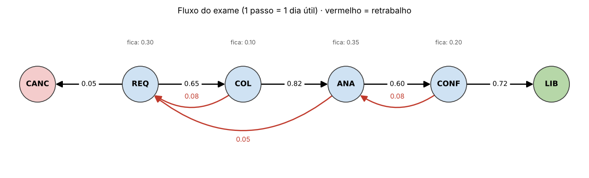
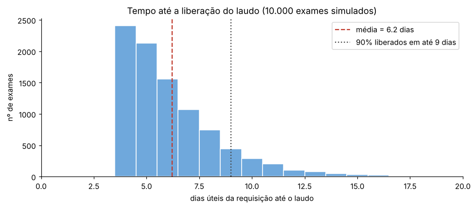
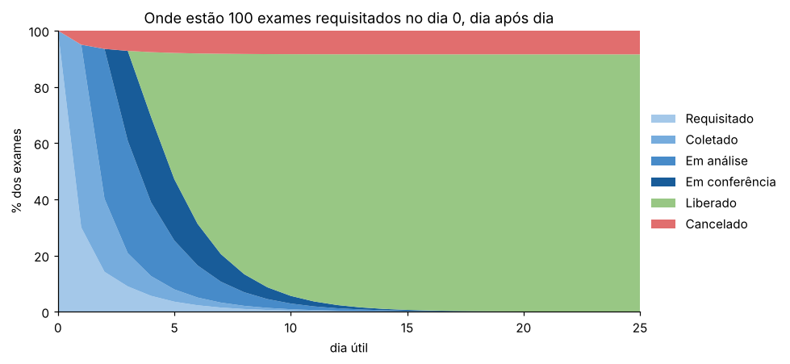

# Cadeia de Markov: o caminho de um exame no laboratório municipal

Ponderada · Módulo 8 · Inteli — Débora Nogueira

[](https://colab.research.google.com/github/deborangueira/ponderada-comp-m8-s3-regis/blob/main/markov_laboratorio.ipynb)

## Entregáveis

| | Link |
|---|---|
| Vídeo de apresentação (até 5 min) | [Pasta no Google Drive](https://drive.google.com/drive/folders/15Mb35bFwGyzI5bn78hBvauTOPhVcAGRb?usp=sharing) |
| Notebook no Google Colab | [Abrir no Colab](https://colab.research.google.com/github/deborangueira/ponderada-comp-m8-s3-regis/blob/main/markov_laboratorio.ipynb) |
| Notebook no repositório | [markov_laboratorio.ipynb](markov_laboratorio.ipynb) |

## Enunciado

Fazer a simulação de uma cadeia de Markov em um Google Colab e gravar um vídeo de até 5 minutos descrevendo o problema modelado, a matriz de transição de estados e os resultados da simulação.

## O problema

Esta atividade modela, com uma cadeia de Markov de tempo discreto, a jornada de um exame dentro de um laboratório de saúde municipal, desde a criação da requisição até a liberação do laudo ou o cancelamento do pedido. O contexto se inspira no módulo de Laboratório do e-Cidade, com o qual o grupo trabalha no módulo 8, e as probabilidades são hipotéticas, definidas para fins de estudo, sem uso de dados reais de municípios. A pergunta que o modelo responde é a que uma gestão de laboratório faria: em quanto tempo, em média, um exame requisitado vira laudo, que fração dos exames se perde no caminho e qual etapa mais pesa nesse tempo, considerando que o fluxo não é linear, já que amostras são rejeitadas e recoletadas e resultados voltam para reanálise.

O passo de tempo é de 1 dia útil. A cada dia, o exame permanece na etapa em que está (fila), avança, volta (retrabalho) ou é cancelado. Como o processo depende apenas da etapa atual, e não do caminho percorrido até ela, ele satisfaz a propriedade de Markov.

| Estado | Significado | Tipo |
|---|---|---|
| Requisitado (REQ) | Requisição criada, aguardando coleta | transitório |
| Coletado (COL) | Amostra coletada, em transporte ou triagem | transitório |
| Em análise (ANA) | Amostra em processamento no setor técnico | transitório |
| Em conferência (CONF) | Resultado aguardando validação do bioquímico | transitório |
| Liberado (LIB) | Laudo liberado | absorvente |
| Cancelado (CANC) | Requisição cancelada | absorvente |

## Matriz de transição

Cada linha indica o estado de hoje e cada coluna, o estado de amanhã. Todas as linhas somam 1.

| de \ para | REQ | COL | ANA | CONF | LIB | CANC |
|---|---|---|---|---|---|---|
| **REQ** | 0,30 | 0,65 | 0 | 0 | 0 | 0,05 |
| **COL** | 0,08 | 0,10 | 0,82 | 0 | 0 | 0 |
| **ANA** | 0,05 | 0 | 0,35 | 0,60 | 0 | 0 |
| **CONF** | 0 | 0 | 0,08 | 0,20 | 0,72 | 0 |
| **LIB** | 0 | 0 | 0 | 0 | 1 | 0 |
| **CANC** | 0 | 0 | 0 | 0 | 0 | 1 |



As setas vermelhas são os retrabalhos: recoleta por amostra rejeitada na triagem (COL → REQ, 8%), amostra inviável durante a análise (ANA → REQ, 5%) e resultado devolvido pelo bioquímico para reanálise (CONF → ANA, 8%).

## Resultados

A simulação de Monte Carlo acompanhou 10.000 exames, cada um partindo de Requisitado, até a absorção. Os valores foram conferidos com a solução analítica da cadeia absorvente, pela matriz fundamental N = (I − Q)⁻¹.

| Métrica | Teoria | Simulação |
|---|---|---|
| Exames liberados | 91,55% | 91,77% |
| Exames cancelados | 8,45% | 8,23% |
| Dias úteis até o fim (média) | 5,88 | 5,86 |

Entre os exames liberados, a simulação mostra média de 6,2 dias úteis, mediana de 6 e 90% dos laudos liberados em até 9 dias. Cerca de 15% dos exames passam por pelo menos uma recoleta e 9% por pelo menos uma reanálise.



A evolução da distribuição de estados (π_t = π₀ Pᵗ) mostra que, partindo de 100 exames requisitados, cerca de 45 estão liberados no 5º dia útil e 86 no 10º, com a fração de cancelados estabilizando em torno de 8,4%.



A matriz fundamental indica que um exame recém-requisitado passa, em média, cerca de 1,7 dia em análise e 1,7 dia aguardando coleta (incluindo recoletas), o que aponta essas duas etapas como as que mais pesam no tempo total. Um teste de cenários reforça essa leitura: reduzir a fila da análise de 35% para 20% diminui o tempo médio de 5,88 para 5,50 dias, enquanto reduzir a rejeição na triagem de 8% para 4% o leva a 5,76 dias.

## Limitações

O modelo assume falta de memória (um exame recoletado duas vezes se comporta como um recoletado nenhuma vez), probabilidades constantes ao longo do tempo e uma única matriz para todos os tipos de exame. Com o histórico real de mudanças de situação dos exames, as probabilidades poderiam ser estimadas pela contagem das transições observadas.

## Como executar

Abra o notebook pelo botão "Abrir no Colab" e execute **Ambiente de execução → Executar tudo**. As bibliotecas usadas (numpy, pandas, matplotlib e networkx) já vêm instaladas no Colab, e a semente aleatória é fixa, então os resultados se repetem a cada execução.

## Estrutura

```
markov_laboratorio.ipynb   notebook com o modelo, a simulação e a análise
assets/                    figuras geradas pelo notebook
```
